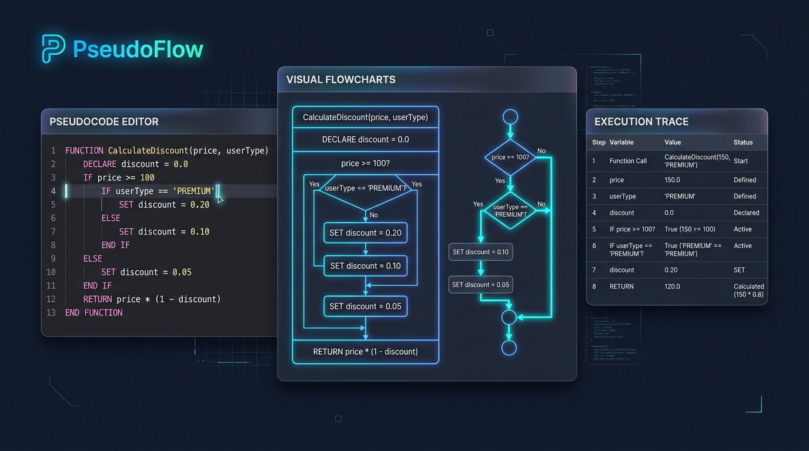

# PseudoFlow - Editor de Pseudocódigo Online y Diagramas de Flujo



> **Sitio Oficial / Despliegue en Vivo**: [https://pseudoflow.pages.dev/](https://pseudoflow.pages.dev/)  
> **Repositorio GitHub**: [https://github.com/daniel95-sv/PseudoFlow.git](https://github.com/daniel95-sv/PseudoFlow.git)

**PseudoFlow** es una aplicación web interactiva que unifica un entorno didáctico completo para aprender a programar ejecutando pseudocódigo en el navegador, generando automáticamente diagramas de flujo, estructogramas de Nassi-Shneiderman y tablas de prueba de escritorio sincronizadas en tiempo real.

Se ejecuta **100% en el lado del cliente** sin necesidad de instalación ni backend.

---

## 🚀 Características Principales

1. **4 Superficies Sincronizadas en Tiempo Real**:
   - **Editor de Código**: Numeración de líneas, coloreado sintáctico e iluminación en tiempo real de la sentencia en ejecución.
   - **Ordinograma (Diagrama de Flujo SVG)**: Generación geométrica automática basada en el AST del algoritmo con resaltado activo del bloque en ejecución.
   - **Estructograma (Nassi-Shneiderman)**: Visualización estructurada de bloques secuenciales, condicionales (`Si / SiNo`) y bucles (`Mientras`, `Repetir`, `Para`).
   - **Tabla Dinámica de Escritorio (Trace Desk)**: Seguimiento paso a paso del estado de la memoria, valores de variables en cada paso, soporte de paso por referencia y aliasing/identidad de objetos (`#1`, `#2`).

2. **Superficies Adicionales**:
   - **Diagrama de Clases UML**: Representación automática de clases, atributos, métodos y jerarquías de herencia (`HeredaDe`).
   - **Transpilación en Vivo**: Conversión inmediata del pseudocódigo a código idiomático en **Python 3** y **Rust**.

3. **Motor de Ejecución 100% en Cliente**:
   - Analizador léxico (Lexer) y sintáctico (Parser) descendente recursivo completo.
   - Intérprete paso a paso con control de velocidad (0.5x, 1x, 2x, 4x, 8x), pausa, reanudación y ejecución completa.
   - Consola de entrada/salida interactiva (`Escribir` y `Leer`).
   - Soporte exhaustivo para Programación Orientada a Objetos: `Clase`, `Constructor`, `Metodo`, `Este` (this), `Super`, creación de instancias (`Instanciar` / `new`) y enlace dinámico.

4. **Ruta Pedagógica Completa**:
   - **15 Módulos** organizados en los 3 Tramos oficiales:
     - **Tramo A**: Fundamentos y lógica estructurada básica.
     - **Tramo B**: Funciones, procedimientos, alcance y modularización.
     - **Tramo C**: Programación Orientada a Objetos, estructuras dinámicas y algoritmos avanzados.
   - **95 Ejercicios Guiados**: Con enunciados completos, código inicial, soluciones de referencia y **suite de validación automática** de casos de prueba visibles y ocultos.
   - **86 Ejemplos Ejecutables**: Catálogo completo de algoritmos listos para cargar y ejecutar con un clic.

5. **Diseño y Estética**:
   - Paleta cromática slate navy moderna con sistema de diseño de tokens y modo oscuro/claro nativo.
   - Soporte bilingüe (**Español** e **Inglés**) para palabras reservadas del pseudocódigo y de la interfaz.

---

## 🛠️ Tecnologías

- **Framework**: React 19 + TypeScript
- **Bundler**: Vite 6
- **Iconografía**: Lucide React
- **Estilos**: Vanilla CSS con variables CSS nativas
- **Despliegue**: Cloudflare Pages (`https://pseudoflow.pages.dev/`)

---

## 📦 Instalación y Ejecución Local

```bash
# 1. Clonar el repositorio
git clone https://github.com/daniel95-sv/PseudoFlow.git
cd PseudoFlow

# 2. Instalar dependencias
npm install

# 3. Iniciar el servidor de desarrollo Vite
npm run dev
```

Abre `http://localhost:5173/` en tu navegador.

### Compilar para Producción

```bash
npm run build
```

Los archivos optimizados se generarán en la carpeta `dist/`.

---

## 🌐 Despliegue en Cloudflare Pages

### Opción A: Conexión Automática con GitHub (Recomendada)
1. En [Cloudflare Dashboard](https://dash.cloudflare.com/) ve a **Workers & Pages** > **Create application** > **Pages** > **Connect to Git**.
2. Selecciona el repositorio `daniel95-sv/PseudoFlow`.
3. Configuración de Build:
   - **Framework preset**: `Vite`
   - **Build command**: `npm run build`
   - **Build output directory**: `dist`
4. Clic en **Save and Deploy**. Cloudflare generará tu dominio `https://pseudoflow.pages.dev/`.

### Opción B: Despliegue Directo con Wrangler
```bash
npm run build
npx wrangler pages deploy dist --project-name=pseudoflow
```

### Guía de Operaciones, Cuotas y Rollback
Para consultar el catálogo completo de cuotas y límites de memoria del motor, políticas de caché HTTP y el procedimiento de reversión inmediata (rollback) en producción, consulta la [Guía de Despliegue y Operaciones (DEPLOYMENT.md)](./DEPLOYMENT.md).

---

## 📄 Licencia

Código abierto bajo licencia MIT. Desarrollado con fines educativos y de divulgación algorítmica.
